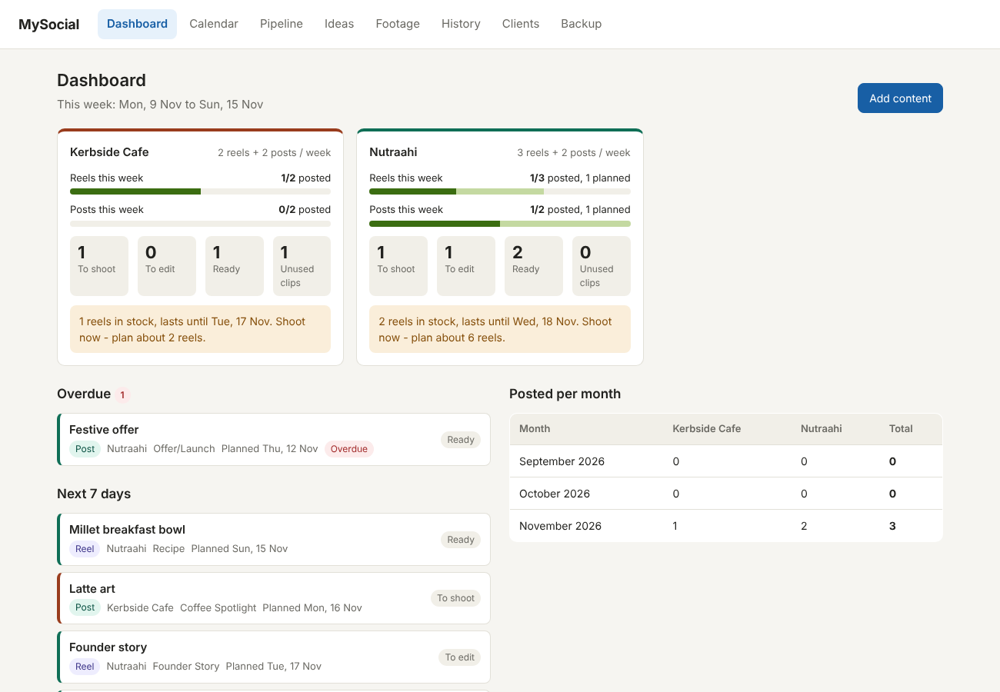
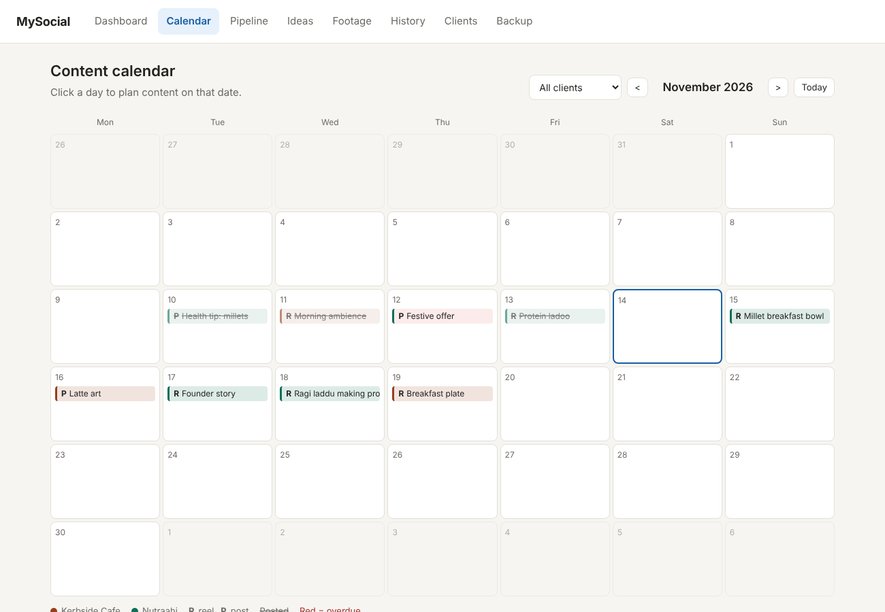
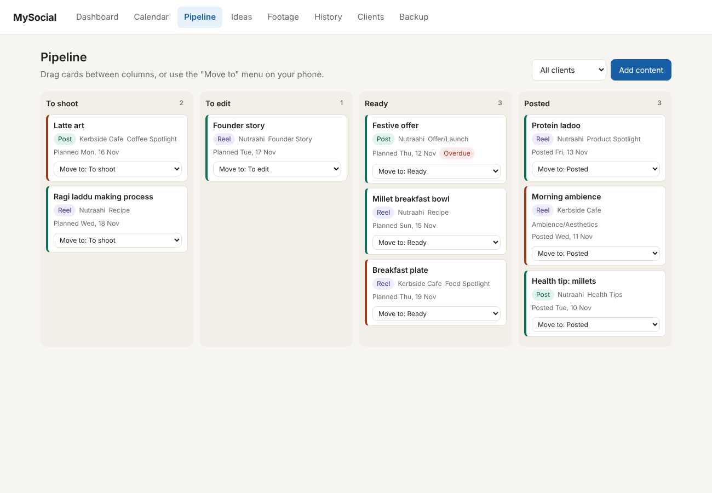

# MySocial

A content tracker for social media managers who handle several Instagram clients at once.

## The problem

I manage Instagram for multiple clients, each with a weekly target (for example 3 reels and 2 posts a week for one brand, 2 reels and 2 posts for another). Across WhatsApp chats, phone galleries and notes, I kept losing track of what was posted, what was still pending, and when I needed to plan the next shoot.

MySocial puts every client, every piece of content and every posting date in one place.

## Features

- **Dashboard**: weekly progress against each client's target, pending and ready counts, overdue items, and what's planned for the next 7 days.
- **Shoot alert**: counts the reels you already have in stock and tells you when to plan the next shoot before you run out.
- **Content calendar**: month view with one colour per client. Click any day to plan content for it.
- **Pipeline board**: drag content through To shoot, To edit, Ready and Posted. On mobile, use the "Move to" menu.
- **Idea bank**: save ideas and trends (with reference links) and turn them into content when you're ready.
- **Footage library**: log raw clips you already have, tagged by client and category, so you can make content without a new shoot.
- **Posting history**: every reel and post that went live, with dates and Instagram links. Add older posts to complete the record.
- **Clients**: add any number of clients with their own weekly targets, content categories and shoot rhythm. Pause a client without losing history.
- **Backup**: export and import all data as a JSON file.

## Screenshots





## Tech

- Plain HTML, CSS and JavaScript with no frameworks or build step
- Data saved in the browser with `localStorage`
- Hosted on GitHub Pages

## Project structure

```
index.html        Page layout and navigation
css/style.css     All styles, including mobile layout
js/store.js       Data layer: saving, loading, date helpers and calculations
js/app.js         User interface: pages, forms and interactions
```

## Run it locally

Download the project and open `index.html` in a browser. That's it.

## Deploy on GitHub Pages

1. Push the project to a GitHub repository.
2. Go to **Settings > Pages**.
3. Under "Build and deployment", choose **Deploy from a branch**, select `main` and `/ (root)`, then save.
4. Your app will be live at `https://<your-username>.github.io/<repo-name>/` in a minute or two.

## Important: your data

Data is saved in the browser you use, on that device only. Anyone can open the app link, but they get their own empty copy and can't see your data.

Use **Backup > Export backup** regularly. To move to another device, export there and import on the new one.

## Roadmap

- v2: login and cloud sync, so data works across laptop and phone and interns can share one workspace
- Assign content to team members
- Monthly invoice reminders per client
- Reach and views tracking per post

## Author

Built by Vikas Kapuganti.
